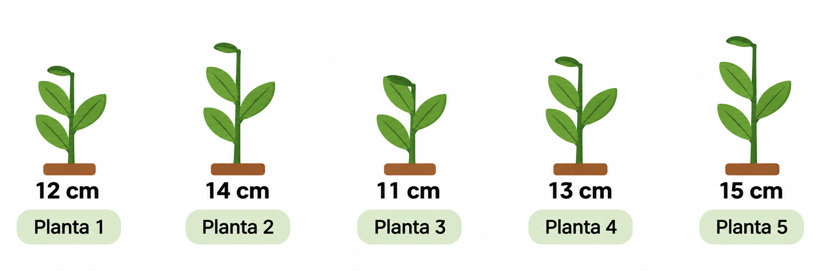

# Primeiros passos

Nesta primeira aula, vamos conhecer o ambiente de programação R, aprender a executar comandos e utilizar o R para realizar operações matemáticas.

Ao longo da aula, trabalharemos com um pequeno conjunto de dados de altura de plantas. 

## 1. Conhecendo o R e o RStudio

O **R** é uma linguagem de programação utilizada para organizar, manipular, analisar e visualizar dados.

O **RStudio** é um ambiente que facilita o trabalho com R, permitindo escrever códigos, visualizar resultados e organizar nossas análises.

## 2. Usando o R como calculadora

Vamos imaginar que medimos a altura de cinco plantas, conforme a imagem abaixo.



Antes de organizar esses dados, vamos aprender a realizar
algumas operações matemáticas no R.

### Adição (+)

Qual é a soma das alturas das plantas A e C?

```{r}
12+11
```

### Subtração(-)

Qual é a diferença de altura entre as plantas E e B?

```{r}
15-14
```

### Multiplicação(*)

Se tivéssemos três plantas com a mesma altura da planta A, qual seria a soma de suas alturas?

```{r}
12*3
```

### Divisão (/)

Se dividirmos a soma das alturas das cinco plantas pelo número de plantas, qual será o resultado?

```{r}
(12+14+11+13+15)/5
```

### Divisão inteira e resto da divisão

Imagine que temos **15 plantas** e queremos distribuí-las igualmente em **4 grupos**, sem dividir nenhuma planta.

Primeiro, vamos realizar uma divisão comum:

```{r}
15/4
```

O resultado é 3,75. Entretanto, não podemos colocar 3,75 plantas em cada grupo.

Para resolver esse problema, podemos utilizar dois operadores:

- **`%/%` (divisão inteira):** informa quantas plantas inteiras cabem em cada grupo.
- **`%%` (resto da divisão):** informa quantas plantas sobram após a distribuição.

**Quantas plantas ficarão em cada grupo?**

```{r}
15 %/% 4
```

O resultado é **3**, ou seja, cada grupo receberá 3 plantas.

**Quantas plantas sobrarão?**

```{r}
15 %% 4
```

O resultado também é **3**, mas agora representa as plantas que não foram distribuídas.

Podemos conferir:

```{r}
4 * 3 + 3
```

### Vamos praticar!

Agora imagine que temos **17 plantas** para distribuir entre **5 grupos**.

1. Quantas plantas inteiras ficarão em cada grupo?
2. Quantas plantas sobrarão?

Utilize os operadores `%/%` e `%%` para descobrir.


### Exponenciação (`^`)

Para calcular potências no R, podemos utilizar os operadores `^` ou `**`.

```{r}
3^2
3**2

5^3
5**3
```

Os dois operadores produzem o mesmo resultado.

### Radiciação

Para calcular raízes quadradas, podemos utilizar a função `sqrt()`.

```{r}
sqrt(144)
```

Também podemos utilizar a potenciação com expoentes fracionários:

```{r}
144^(1/2)
8^(1/3)
```

### Logaritmos

O R também permite calcular logaritmos de diferentes bases.

A função `log()` calcula, por padrão, o logaritmo natural, enquanto `log10()` calcula o logaritmo na base 10.

```{r}
log(100)
log10(100)
```

Podemos especificar outras bases:

```{r}
log(8, base = 2)
```

### Expressões numéricas

Assim como na matemática, podemos combinar diferentes operações em uma mesma expressão.

```{r}
4*3-9
```

Os parênteses permitem modificar a ordem das operações.

```{r}
(4*3)-9
4*(3-9)
```

### Sequências de números

No R, podemos criar sequências de números utilizando o operador `:`.

Por exemplo, para gerar uma sequência de 1 a 5, representando as cinco plantas do nosso experimento:

```{r}
1:5
```

Também podemos criar sequências maiores ou em ordem decrescente:

```{r}
0:30
17:58
10:-10
```

Observe que o R identifica automaticamente se a sequência deve ser crescente ou decrescente.

### Combinando sequências e expressões numéricas

Podemos combinar o operador `:` com as operações matemáticas que aprendemos anteriormente.

Observe os exemplos:

```{r}
5:(2 * 3 + 10)
```

Primeiro, o R calcula a expressão entre parênteses:

`2 * 3 + 10 = 16`

Depois, gera uma sequência de 5 até 16.

Também podemos realizar operações com todos os elementos de uma sequência:

```{r}
(4:9) * 2
```

Nesse caso, o R cria a sequência de 4 a 9 e multiplica cada elemento por 2.

### Vamos praticar!

1. Crie uma sequência que represente 20 plantas numeradas de 1 a 20.
2. Crie uma sequência decrescente de 15 até 1.
3. Utilizando uma única expressão, gere uma sequência de 1 a 10 e multiplique todos os valores por 3.

**Desafio:** Observe o comando abaixo e tente descobrir qual será o resultado antes de executá-lo.

```{r}
5:2 * 3 + 10
```

Compare com:

```{r}
5:(2 * 3 + 10)
```

Por que os resultados são diferentes?

**Vamos praticar!**

Utilizando as alturas das cinco plantas, escreva comandos para:

1. Calcular a soma das alturas das plantas 2, 3 e 5.
2. Calcular a diferença entre a planta mais alta e a mais baixa.
3. Calcular a altura média das cinco plantas utilizando uma expressão matemática.

## 3. Criando e armazenando objetos

Até agora, utilizamos o R para realizar operações matemáticas. Mas e se precisássemos utilizar os mesmos valores várias vezes?

No R, podemos armazenar informações em **objetos**, atribuindo um nome a determinado valor ou resultado.

Para criar um objeto, utilizamos o operador de atribuição `<-`.

Vamos armazenar a altura de cada uma das nossas plantas.

```{r}
planta1 <- 12
planta2 <- 14
planta3 <- 11
planta4 <- 13
planta5 <- 15
```

Para consultar o valor armazenado, basta escrever o nome do objeto.

```{r}
planta1
```

Também podemos criar e visualizar um objeto utilizando parênteses:

```{r}
(planta6 <- 16)
```

E dessa forma:
```{r}
planta6 <- 16; planta6
```

**Atenção:** o R diferencia letras maiúsculas e minúsculas. Portanto, `planta1` e `Planta1` seriam objetos diferentes.

### Operações com objetos

Depois de armazenar os valores, podemos utilizá-los em expressões matemáticas.

Qual é a soma das alturas das plantas 1 e 3?

```{r}
planta1 + planta3
```

Qual é a diferença entre as plantas 5 e 2?

```{r}
planta5 - planta2
```

Qual é a altura média das cinco plantas?

```{r}
(planta1+planta2+planta3+planta4+planta5)/5
```

Também podemos armazenar o resultado dessa operação em um novo objeto.

```{r}
media_altura <- (planta1+planta2+planta3+planta4+planta5)/5

media_altura
```

### Removendo objetos

Quando não precisamos mais de um objeto, podemos removê-lo utilizando a função `rm()`.

```{r}
rm(planta6)
```

Se tentarmos consultar um objeto que foi removido, o R apresentará uma mensagem de erro.

**Vamos praticar!**

1. Crie um objeto chamado `amplitude` que armazene a diferença de altura entre as plantas 5 e 3.
2. Consulte o valor armazenado nesse objeto.
3. Crie um objeto chamado `dobro` que armazene o dobro da altura da planta 4.

## 4. Trabalhando com vetores

Até agora, criamos um objeto para cada planta. Mas imagine que nosso experimento tivesse 100 ou 1.000 plantas. Seria prático criar um objeto diferente para cada observação?

Para armazenar vários valores em um único objeto, podemos utilizar os **vetores**.

Um vetor é uma estrutura que permite armazenar vários elementos do mesmo tipo.

### Criando vetores

Uma das formas mais comuns de criar vetores é utilizando a função `c()`, que combina diferentes valores em um único vetor.

Vamos reunir as alturas das cinco plantas.

```{r}
altura <- c(12, 14, 11, 13, 15)

altura
```

Agora, todas as alturas estão armazenadas no objeto `altura`.

Podemos utilizar funções para obter informações sobre esses valores.

```{r}
length(altura)  # Número de observações
sum(altura)     # Soma das alturas
mean(altura)    # Média das alturas
min(altura)     # Menor altura
max(altura)     # Maior altura
sd(altura)      # Desvio padrão amostral
```

### Criando sequências de números

O operador `:` permite criar sequências de números inteiros consecutivos.

```{r}
1:5
0:30
17:58
10:-10
```

Podemos combinar sequências com expressões matemáticas.

```{r}
5:(2 * 3 + 10)
(4:9) * 2
```

### Consultando elementos de um vetor

Podemos acessar elementos específicos de um vetor utilizando colchetes `[ ]`.

Qual é a altura da terceira planta?

```{r}
altura[3]
```

E se quisermos consultar as alturas das plantas 1 e 5?

```{r}
altura[c(1, 5)]
```

Também podemos consultar um intervalo de posições.

```{r}
altura[2:4]
```

Para excluir uma posição da consulta, utilizamos o sinal negativo.

```{r}
altura[-3]
```

Isso não remove o elemento do vetor original. Apenas retorna os demais elementos.

### Operações com vetores

Uma vantagem dos vetores é que podemos realizar operações com todos os seus elementos de uma só vez.

Imagine que queremos converter as alturas das plantas de centímetros para milímetros.

```{r}
altura * 10
```

E se quisermos converter as alturas para metros?

```{r}
altura / 100
```

Também podemos elevar todos os valores ao quadrado.

```{r}
altura^2
```

### Operações entre vetores

Podemos realizar operações entre dois vetores de mesmo comprimento.

Imagine que as mesmas cinco plantas foram medidas novamente após determinado período.

```{r}
altura_inicial <- c(12, 14, 11, 13, 15)

altura_final <- c(17, 18, 16, 19, 20)
```

Qual foi o crescimento de cada planta?

```{r}
crescimento <- altura_final - altura_inicial

crescimento
```

Qual foi o crescimento médio?

```{r}
mean(crescimento)
```

**Vamos praticar!**

1. Consulte a altura da quarta planta.
2. Consulte as alturas das plantas 2, 3 e 5.
3. Crie um vetor contendo as alturas das cinco plantas em milímetros.
4. Calcule a soma das alturas das cinco plantas utilizando `sum()`.
5. Descubra qual foi o maior crescimento entre as duas avaliações.

## 5. Desafio final

Agora é sua vez de trabalhar com um novo conjunto de dados!

Em outro experimento, foram avaliadas seis plantas, cujas alturas foram:

**18, 21, 19, 24, 20 e 22 cm.**

Utilizando o que aprendemos nesta aula:

1. Crie um vetor chamado `altura_experimento` com as seis observações.
2. Descubra quantas plantas foram avaliadas.
3. Calcule a altura média.
4. Identifique a menor e a maior altura.
5. Consulte a altura da quinta planta.
6. Calcule a amplitude das alturas (maior valor menos o menor).
7. Converta todas as alturas para milímetros.
8. Armazene a média em um objeto chamado `media_experimento`.